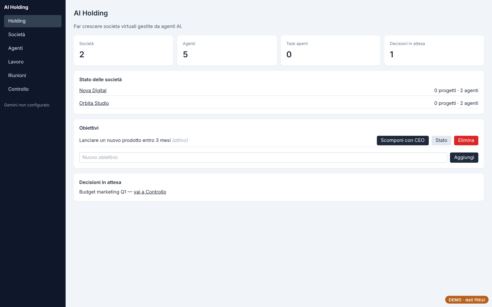
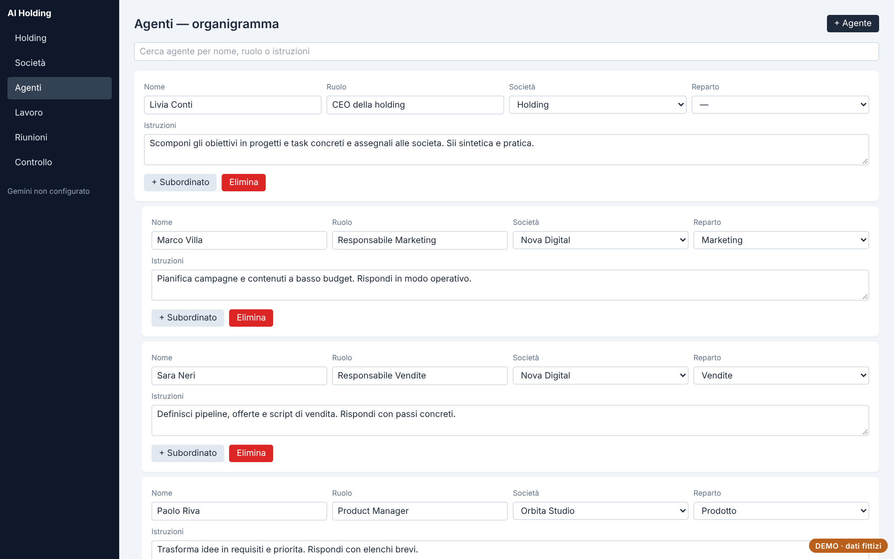
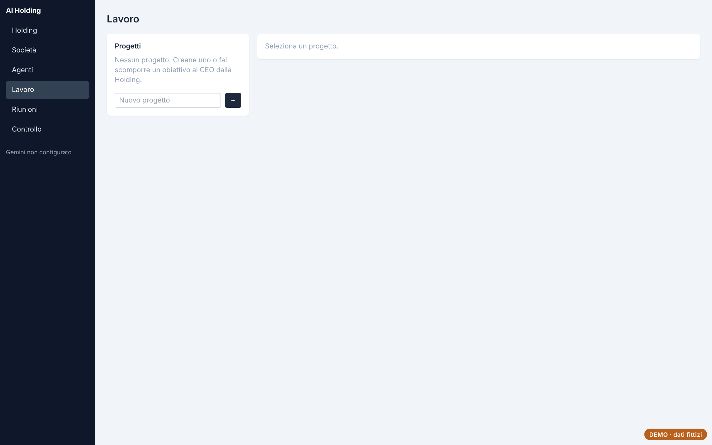
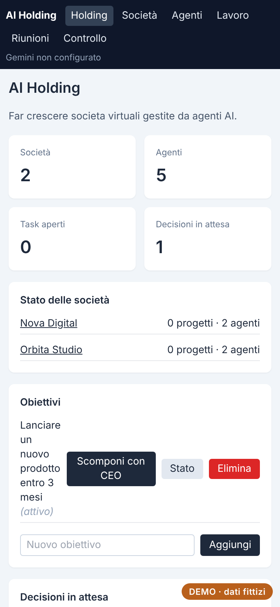

# AI Holding

Simulatore di una holding con società virtuali gestite da agenti AI: obiettivi, progetti, task, riunioni e decisioni da approvare.

**[Prova la demo](https://andreapollastrelli95.github.io/ai-holding-demo/)** · dati fittizi, salvati solo nel tuo browser; nella demo l'assistente AI è disattivato.



## Cosa fa

- **Holding e società**: struttura con società, reparti e agenti, ognuno con ruolo e istruzioni.
- **Agenti AI**: il CEO scompone gli obiettivi in progetti e task e li assegna alle società; ogni agente risponde secondo il proprio ruolo.
- **Lavoro e riunioni**: task con stato e responsabile, verbali delle riunioni tra agenti.
- **Controllo**: decisioni in attesa di approvazione, registro delle attività, esportazione e importazione dei dati con verifica del file.

| Agenti | Lavoro | Telefono |
|---|---|---|
|  |  |  |

## Come è fatto

React, TypeScript, Vite, Tailwind CSS, Dexie (IndexedDB), React Router; server Node per la sincronizzazione e il collegamento a Google Gemini; Electron per la versione desktop.

I dati vivono nel browser (IndexedDB) e vengono sincronizzati con un archivio centrale tramite `/api/data`, con controllo di versione per non sovrascrivere le modifiche fatte da un altro dispositivo. Nella demo `public/demo-api.js` sostituisce il server con un archivio locale che segue le stesse regole.

## Avviarlo in locale

```bash
npm install
npm run dev      # sviluppo
npm run build    # versione web in dist/
```

---

Progetto di [Andrea Pollastrelli](https://andreapollastrelli95.github.io/).
